  <h3><code>gabriel@github ~ $ ./contributions.sh</code></h3>
  
    
  <h3><code>gabriel@github ~ $ whoami</code></h3>
  <table>
    <tr>
      <td valign="top"></td>
      <td valign="top"></td>
    </tr>
  </table>
   
  

    <a href="https://www.linkedin.com/in/gabrielvmendes-dev">LinkedIn</a> ·
    <a href="https://github.com/Gabriel-V-Mendes?tab=repositories">Repositórios</a> ·
    <a href="mailto:gabrieldovalemendes@gmail.com">Email</a>
  

